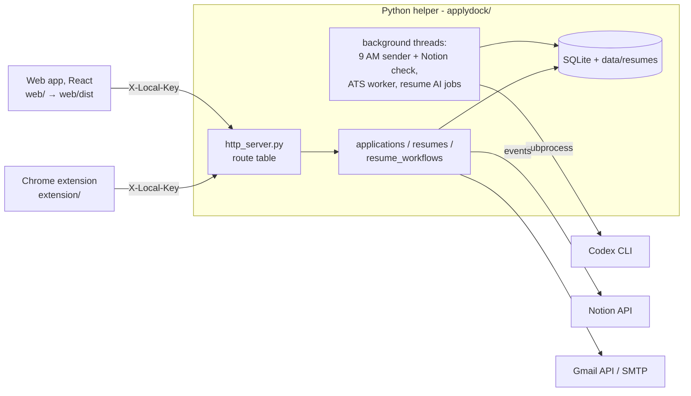

# Architecture

ApplyDock is a single-user, local application. One Python process, the "helper", serves a JSON API and the built web app on `127.0.0.1:8765`. It stores everything in SQLite plus content-addressed files, and runs three background threads. A Chrome extension and the web app are its only clients. Node.js is only a build tool: nothing Node runs at runtime.



## Repository layout

```text
server.py                 entry point used by start.cmd (calls applydock.app.main)
applydock/                Python helper (package)
  config.py               paths, constants, settings (data/config.json), DPAPI secrets — no import side effects
  database.py             SQLite connection, schema, versioned migrations + backup
  events.py               "application changed" notifications (Notion sync listens)
  applications.py         captured jobs/posts ("entries"): capture, URLs, editing, approval, stages
  resumes.py              resume library, versions, pinned/current file selection, access links
  resume_workflows.py     resume editor orchestration: editor state, import, tailor, suggestions, save version
  profile.py              Master Profile entries, import from resume, evidence blocks for analysis/suggestions (DB layer)
  linkcheck.py            on-demand, SSRF-safe reachability checks for project links
  submissions.py          immutable record of the exact resume file submitted per application (DB layer)
  career.py               Master Profile and submission workflows over HTTP
  resume_model.py         structured resume schema, edits, diffs, fact guard (pure functions)
  resume_import.py        PDF text -> structured resume (local heuristic + Codex prompt/grounding)
  resume_render.py        Typst rendering, fit-to-page, post-render PDF validation
  resume_store.py         drafts, editor versions, tailored copies, AI job queue, suggestions (DB layer)
  ats.py                  resume/job text extraction, Codex runner, ATS analysis queue + scoring
  notion.py               Notion schema mapping, push, inbound edits, trash reconciliation
  gmail.py                Gmail OAuth (PKCE) and draft creation
  delivery.py             SMTP verification and the 9 AM sender/scheduler loop
  ai_draft.py             Codex-written email drafts
  http_server.py          request handler, auth, static files, @route table
  app.py                  startup: settings, migration, workers, server
  schemas/                Codex structured-output JSON schemas
  resume_templates/       Typst templates + bundled Carlito fonts (OFL)
web/                      React web app (TypeScript, Vite); built into web/dist, which the helper serves
  src/main.tsx            providers; imports bridge/extension.ts first
  src/app/                router, AppShell (pairing gate), TopBar, extension deep-link handler, dev-only /kit gallery
  src/api/                payload types, TanStack Query client/keys, per-domain hooks (analyses, drafts, profile, resumes, settings)
  src/bridge/extension.ts applydock-paired / applydock-open listeners, registered before the first render
  src/components/ui/      design-system primitives (Radix + Tailwind, see DESIGN.md)
  src/features/           applications, analysis, resume-library, resume-editor, profile, settings — one folder per screen
  src/lib/                api client (sole holder of the pairing key), domain rules, formatting, theme
  src/styles/             tokens.css (Ledger colors) + globals.css (@theme scales)
  e2e/                    Playwright specs against tests/ui/sandbox.py (incl. the extension side panel and design rules)
extension/                Chrome MV3 side panel (own copy of its UI code)
tests/                    unittest suites, tests/ui/sandbox.py (seeded helper for browser tests), fixtures
scripts/check.py          runs every check (Python, extension, web check + build, Playwright with --ui)
docs/                     this documentation
```

## Module layering

Dependencies point one way. `tests/test_architecture.py` enforces this and fails on any import cycle.

```text
config, events, resume_model           (no ApplyDock imports)
  -> database, ats, resume_import, resume_render, resume_store
    -> resumes
      -> applications
        -> notion, gmail, delivery, ai_draft, resume_workflows
          -> http_server -> app
```

`resumes` must not import `applications` (applications already depend on resumes). When resume changes affect applications, `resumes` queries `entries` with SQL and calls `events.application_changed(entry_id)`. `app.start_workers()` subscribes `notion.sync_entry` to that event, so the domain modules never import Notion. Tests run with no listeners.

**Settings and paths are read as attributes** (`config.DATA`, `config.SETTINGS`), never copied with `from config import ...`. That keeps one switch point for tests, the sandbox and `APPLYDOCK_DATA_DIR`.

## Request flow

1. `Handler.do_GET` and `do_POST`/`PATCH`/`DELETE` call `dispatch_get` or `dispatch_mutation`.
2. Public GETs are handled first:
   - the Gmail OAuth callback;
   - resume file links that carry their own `?access=` token;
   - the web app (`http_server.web_file`):
     - files under `web/dist` with an allowed suffix (`.js .css .woff2 .svg .png .ico`);
     - `index.html` for any other path outside `/api/` and `/oauth/`, because the app routes on the client;
     - `/app/...` (the preview URL used during the migration) redirects to `/...`.
3. Everything else passes `authorized()`: the Host must be the loopback host and port, the Origin (if present) must be the dashboard or a Chrome extension, and `X-Local-Key` must match the pairing key (compared in constant time).
4. The route is looked up in `ROUTES`. Mutations read the JSON body (12 MB maximum) before routing, as before; DELETE routes take no body.
5. The handler returns a dict (sent as 200 JSON) or a `FileResponse`. Exceptions become JSON errors: `NotFound` gives 404, `ConflictError` gives 409 (with the current draft), `ValueError`/`KeyError` give 400, and anything else gives 500.

## Data flow (main workflow)

`capture → entries row → choose resume (resumes.current_version_id or pinned entries.resume_version_id) → ats.queue_analysis → ATS worker (Codex parse + match, Python scoring) → analysis_runs → resume editor (draft → Typst PDF → validate → immutable resume_version) → pin version to entry → gmail.save_gmail_draft / delivery.send_mail attach that exact file (SHA-256 re-checked and recorded)`

## Storage

| Store | Contents |
|---|---|
| `entries` | Applications: job fields, email fields, stage, delivery state, `resume_id`, pinned `resume_version_id`, attachment SHA |
| `resumes` | Library items. `kind` is master or tailored; tailored copies record `parent_resume_id` and `entry_id`. `current_version_id` and access token |
| `resume_versions` / `resume_documents` | Immutable versions pointing at content-addressed files `data/resumes/versions/{sha256}.ext`, plus extracted text and caches |
| `resume_drafts`, `resume_suggestions`, `resume_ai_jobs` | Editor working copies (revisioned), AI suggestions, background Codex jobs |
| `analysis_runs`, `analysis_checklist`, `analysis_events`, `ai_runs`, `job_description_versions` | ATS analysis results, progress and telemetry |
| `data/config.json` | Pairing key, Notion mapping, profile. Tokens and passwords are DPAPI-encrypted |

Schema changes are additive and gated by `PRAGMA user_version` (currently 4). `database.backup_before_migration()` copies the database before any upgrade.

## Background work

`app.start_workers()` starts three daemon threads:

| Thread | What it does |
|---|---|
| `delivery.scheduler` | Every 10 seconds: the 9 AM SMTP sender, then a Notion change and trash check (throttled to about every 2 minutes) |
| `ats.worker` | Processes queued analyses one at a time |
| `resume_store.job_worker` | Codex resume imports and suggestions |

Codex runs as a sandboxed, read-only subprocess with prompts on stdin. Output is schema-validated and grounded against local evidence before anything is stored.

## Security boundaries

- **Local only:** the server binds to `127.0.0.1`. The pairing key is required for every API route.
- **Resume links:** `?access=` tokens are scoped. The current-file token rotates when the file changes; per-version tokens never rotate but only open that version.
- **Secrets:** Notion token, SMTP password and Gmail client secret/refresh token are DPAPI-encrypted. `/api/state` never returns them.
- **Static files:** only allowed suffixes inside `web/dist` are served. Path traversal is rejected (tested). Content-hashed files under `assets/` get an immutable cache; the page and everything else get `no-store`.
- **Content-Security-Policy:** the page is sent with:
  - `script-src 'self'`, so the build has no inline scripts;
  - `frame-src` limited to `self`, `blob:` (PDF previews) and the helper origins;
  - `frame-ancestors 'none'`, `object-src 'none'` and `base-uri 'none'`.
- **HTML rendering:** React escapes all text, and `dangerouslySetInnerHTML` is a lint error.
- **AI isolation:** AI never sends email or applies edits on its own. Approvals and suggestion acceptance are explicit user actions.

## Design constraints

- **The web app is built, not run, by Node.**
  - `start.cmd` runs `npm --prefix web run build`, and the helper serves `web/dist`.
  - Dependencies are pinned exactly in `web/package-lock.json`.
  - Without a build, the helper answers `/` with a page explaining how to build.
- **Two Python runtime dependencies** (`pypdf`, `typst`). Use the standard library otherwise.
- **Windows-first:** DPAPI and `start.cmd`. Other platforms work for development, except secret storage.
- **Single user, single process.** `database.LOCK` serializes multi-step writes.

## Where things moved (refactor of 2026-10)

| Before | After |
|---|---|
| `server.py` (2,200 lines) | `applydock/*.py` as above; `server.py` is a 4-line entry point |
| `ats.py`, `resume_*.py` at the root | `applydock/` |
| `*-schema.json` at the root | `applydock/schemas/` |
| `resume_templates/` | `applydock/resume_templates/` |
| `dashboard/app.js` | `dashboard/js/{core,applications,resume-library,analysis,settings,main}.js`, then (2026-10-28) the React app in `web/` (see [WEB_MIGRATION.md](WEB_MIGRATION.md)) |
| `dashboard/resume-editor.js` | `web/src/features/resume-editor/` |
| `tests/ui/*.mjs` (CDP driver) | `web/e2e/*.spec.ts` (Playwright) |
| `server.CONFIG_DATA` | `config.SETTINGS` |
| `server.sync_entry(...)` calls in domain code | `events.application_changed(...)` |
| Planning docs at the root | `docs/archive/` |
